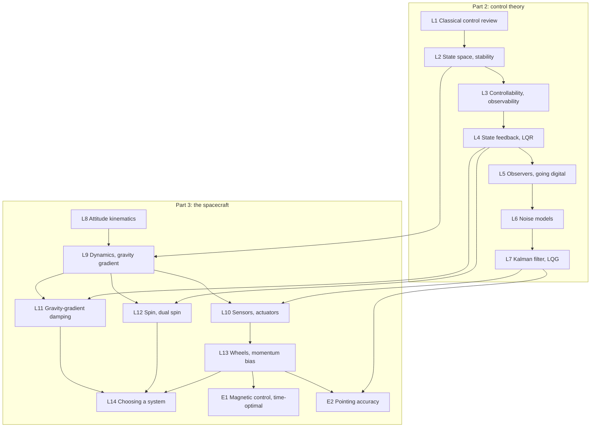

# R7026R Spacecraft Control

Aim of the course: assess and report on the feasibility of different attitude control systems in different situations. Study period 2, autumn 2026 (2 Nov – 11 Dec). Books: FPE = Franklin, Powell and Emami-Naeini, *Feedback Control of Dynamic Systems*; Sidi = *Spacecraft Dynamics and Control* (study guide: [[StudyGuide.pdf]]).

## How to study with these notes
Every lecture note has the same parts. Work through them in this order:
1. **Roadmap**: read it first. Why the lecture exists, its storyline (⭐ = core, must be done by hand on the exam), and a checklist of what you should be able to do afterwards.
2. **Notes**: the content, slide by slide, with plain-words explanations. Slide links open the handout at the right page.
3. **Formulas** and **Common mistakes**: what to have at your fingertips, and the traps that cost points.
4. **Worked example**: cover the solution, solve it by hand, then compare.
5. **Self-test**: answer each question *before* you open the answer.
6. **Practice**: the problem-session and project tasks for that lecture. Do them by hand, with a time limit, like the exam.
7. Tick the checklist in the Roadmap. Come back a few days later to what you could not tick: testing yourself again beats reading again.

The study guide adds: rerun the lecture's MATLAB scripts (every number on the slides comes from them), and keep a one-page summary of each lecture in your own words (that is what the Summary section is for).

## Course map
How the lectures build on each other. Part 2 is a chain: read it in order. In Part 3, L8 and L9 come first, then L10–L13 in any order, and L14 pulls everything together.

**For the projects:** Project 1 needs L3–L7 and L12 (start after L4). Project 2 needs L9, L11 and L12 (start after L9).

## Lectures
**Part 1: introduction**
- [[R7026R L1]] – Review of classical control

**Part 2: control theory**
- [[R7026R L2]] – State-space models and stability
- [[R7026R L3]] – Controllability and observability
- [[R7026R L4]] – State feedback and LQR
- [[R7026R L5]] – Observers, compensators, going digital
- [[R7026R L6]] – Disturbance and noise models
- [[R7026R L7]] – Kalman filter and LQG

**Part 3: the spacecraft**
- [[R7026R L8]] – Attitude kinematics
- [[R7026R L9]] – Attitude dynamics and gravity-gradient stability
- [[R7026R L10]] – Sensors, actuators and attitude determination
- [[R7026R L11]] – Gravity-gradient response and damping
- [[R7026R L12]] – Spin and dual-spin stabilization
- [[R7026R L13]] – Reaction and momentum wheels
- [[R7026R L14]] – Choosing an attitude control system (incl. what to be able to compute for the exam)

**Optional (if given)**
- [[R7026R E1]] – Magnetic attitude control and time-optimal maneuvers
- [[R7026R E2]] – Momentum bias in depth and pointing accuracy

## Problem sessions
Ten problems each; ⋆ = solved together in class. By hand like the exam, unless marked (MATLAB).
- [[ProblemSession_1.pdf|Problem Session 1]] – Lectures 2–5: ⋆3 controllable/observable directions, ⋆5 observable canonical form, ⋆7 pole placement and LQ for a double integrator, ⋆8 observing a GEO station-keeping satellite
- [[ProblemSession_2.pdf|Problem Session 2]] – Lectures 6–10: ⋆3 position or velocity sensor, ⋆4 LQG of an unstable first-order system, ⋆6 Euler angles and the quaternion, ⋆8 linearized attitude equations
- [[ProblemSession_3.pdf|Problem Session 3]] – Lectures 11–14: ⋆2 GG satellite with magnetic damping, ⋆6 fuel for active nutation control, ⋆7 momentum bias with roll-only sensing, ⋆8 position-plus-rate pitch control

## Projects
- [[Project_1.pdf|Project 1]] – Active nutation damping with a Kalman filter and LQG (individual). Start after L4; 4-page IEEE paper + one zip with MATLAB/Simulink files (one script reproduces every figure). **Due 23 Jan 2027, 23:59.** See [[R7026R L12]] (active wheel damper) and [[R7026R L7]].
- [[Project_2.pdf|Project 2]] – Attitude dynamics by hand (individual): principal axes, energy and stable spin, spin stabilized by a rotor, gravity-gradient pitch. Start after L9; some parts need L11–L12. One PDF via Canvas, **due 31 Jan 2027, 23:59**.

## Exam map
What you must be able to compute by hand (Lecture 14, "Before the exam"), where to learn it, and what to practise on. ⋆ = solved in class.

| You must be able to | Learn it in | Practise on |
|---|---|---|
| write a state-space model from an ODE or block diagram; poles as eigenvalues; linearize about an equilibrium | [[R7026R L2]] | [[ProblemSession_1.pdf#page=1\|PS1]] 1, 2 |
| do rank tests: which modes are uncontrollable/unobservable, and what that means physically | [[R7026R L3]] | PS1 ⋆3, 4, ⋆5, ⋆8a |
| compute state-feedback $K$ and observer $L$ by coefficient matching; the reference gain | [[R7026R L4]], [[R7026R L5]] | PS1 ⋆5c,e, ⋆7a–c; PS3 1a |
| do LQR on one axis; say what the weights do | [[R7026R L4]] | PS1 6, ⋆7d |
| make a discrete model from a continuous one; map poles with $z = e^{sh}$ | [[R7026R L5]] | PS1 9, 10 |
| find a shaping filter from a spectrum; do one step of a scalar Kalman filter | [[R7026R L6]], [[R7026R L7]] | [[ProblemSession_2.pdf#page=1\|PS2]] 1, 2, ⋆3, ⋆4, 5 |
| convert between DCM, Euler angles and quaternions; combine two rotations | [[R7026R L8]] | PS2 ⋆6; Project 2, Problem 1 |
| write the linearized roll, pitch, yaw equations; gravity-gradient stability and libration frequencies | [[R7026R L9]] | PS2 7, ⋆8; Project 2, Problem 4 |
| compute steady-state attitude errors under constant disturbances | [[R7026R L11]], [[R7026R L13]] | [[ProblemSession_3.pdf#page=1\|PS3]] ⋆2, 3, ⋆7d, ⋆8 |
| spin: nutation frequency, stability with dissipation, despin; the dual-spin condition | [[R7026R L12]] | PS3 5, ⋆6; Project 2, Problems 2–3 |
| wheels: torque and momentum sizing, dumping, momentum-bias gains and their signs | [[R7026R L13]], [[R7026R L14]] | PS3 1, 4, ⋆7, 9, 10 |
| compute a magnetorquer dipole for a required torque | [[R7026R L10]] | PS3 ⋆2c–d |
| attitude determination (TRIAD, gyro + star tracker) | [[R7026R L10]], [[R7026R L7]] | PS2 9, 10 |
| choose a system for a set of requirements and defend the choice with numbers | [[R7026R L14]] | the five cases of L14; PS3 10 |

Each lecture's **Practice** section links straight to the right page of the problem sessions.

## Key dates
- Project 1: start after Lecture 4; **due 23 Jan 2027, 23:59** (Canvas: "Project"; IEEE paper + zip)
- Project 2: start after Lecture 9; **due 31 Jan 2027, 23:59** (Canvas, one PDF, individual; the problems get harder as it goes, so start early)
- Exam: week of 11–15 Jan 2027 (written, by hand, small models; checklist in [[R7026R L14]])
