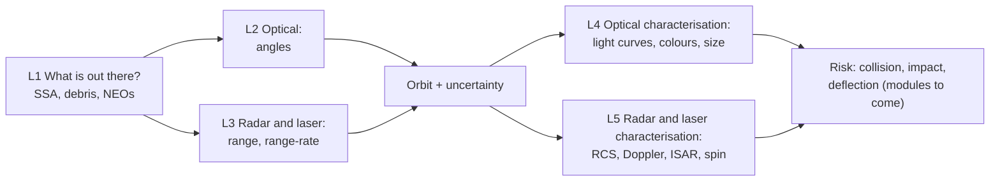

# R7031R Space Situational Awareness and Planetary Defense

How we detect, track and assess objects that may pose risks in space or to Earth: radar, optical and laser observations, orbit determination, cataloguing, collision-risk prediction, debris mitigation, responses to hazardous near-Earth objects, and the legal, political and ethical frameworks behind it. Examiner: Athanasia Toliou; also Georgios Tsirvoulis, René Laufer, Emanuele Tomassi.

## How to study with these notes
Every lecture note has the same parts. Work through them in this order:
1. **Roadmap**: read it first. Why the lecture exists, its storyline (⭐ = core), and a checklist of what you should be able to do afterwards.
2. **Notes**: the content, slide by slide, with plain-words explanations. Slide links open the PDF at the right page.
3. **Formulas** and **Common mistakes**: the numbers and the traps.
4. **Worked example**: cover the solution, solve it yourself, then compare.
5. **Self-test**: answer each question *before* you open the answer.
6. **Practice**: which assignment part the lecture supports, plus extra exercises with answers.
7. Tick the checklist in the Roadmap, and come back a few days later to what you could not tick.

## Course map
The course follows one chain: find an object → measure where it is → know where it will be (and how uncertain that is) → find out what it is → judge the risk.

## Lectures
**Module 1: Introduction & fundamentals**
- [[R7031R L1]] – Introduction: SSA, debris, NEOs and planetary defence

**Module 2: Detection & tracking**
- [[R7031R L2]] – Detection and tracking: optical
- [[R7031R L3]] – Detection and tracking: radar and laser ranging (+ break-up exercise)

**Module 3: Space object characterisation and behaviour analysis**
- [[R7031R L4]] – Characterisation: optical
- [[R7031R L5]] – Characterisation: radar and laser ranging

**Modules still to come** (empty on Canvas so far): Near-Earth objects · Space debris · Policy, law & ethics

## Assignments
- **Assignment 1 – Fengyun-1C event** (10 p, due 18 Nov 2026): take the current debris TLEs from CelesTrak, drop elements older than a day, compare with FY-1C's original orbit: median, std and spread of $a$, $e$, $i$, RAAN (wrapped to ±180°), histograms, perigee/apogee distributions, scatter plots, and a discussion of the cloud's evolution. Background: [[R7031R L1]].
- **Assignment 2 – Astrometry for planetary defense** (20 p, pass 10, due 6 Dec 2026, individual, ~20–25 h): Las Cumbres 1-m frames of (65803) Didymos from NASA PDS, all image work in AstroImageJ. A: FITS header table, mid-exposure times (DATE-OBS + EXPTIME/2), WCS keywords, pixel scale. B: find the asteroid with a JPL Horizons ephemeris (observatory code from SITEID/ENCID/TELID, case-sensitive). C: centroided RA/Dec for all frames, uncertainty from repeats and Gaia DR3 stars (VizieR I/355/gaiadr3). D: O−C residuals vs Horizons with the cos Dec factor, plot, trend? E: MPC 80-column lines from Multi-Aperture, orbit fit in Find_Orb, compare with JPL SBDB, discuss **arc length**. Background: [[R7031R L2]] (astrometry, timing errors).
- **Project report** (group, 2 credits ≈ 50–60 h, pass/fail, due 18 Dec 2026): pick a topic (e.g. a real conjunction event, long-term debris evolution in a 700–800 km SSO shell, close approaches of Apophis or Bennu), agree it with the examiner, send a task breakdown, then report: introduction, methodology, results, discussion, conclusions.

### Where to find the theory for each assignment
| Task | Read |
|---|---|
| Assignment 1: the Fengyun-1C debris cloud | [[R7031R L1]] *Sustainability: fragmentation events* (why a cloud spreads, first along the orbit, then into a shell through $J_2$); [[R7031R L3]] *Exercise: a break-up in LEO* |
| Assignment 2 A: FITS header, mid-exposure times, WCS, pixel scale | [[R7031R L2]] *Telescopes and detectors* and *Bridge to Assignment 2* |
| Assignment 2 B: find Didymos with a Horizons ephemeris | [[R7031R L2]] *Orbit determination and uncertainty* |
| Assignment 2 C: centroided RA/Dec and their uncertainty | [[R7031R L2]] *Astrometry* (centroid precision, Gaia DR3) |
| Assignment 2 D: O − C residuals with $\cos\delta$ | [[R7031R L2]] *Bridge to Assignment 2* (and the self-test exercise) |
| Assignment 2 E: MPC lines, Find_Orb, arc length | [[R7031R L2]] *Orbit determination and uncertainty*: the thin ellipsoid along the line of sight |
| Project: a conjunction or debris-evolution topic | [[R7031R L1]] (density ≠ risk), [[R7031R L2]]–[[R7031R L3]] (which sensors, what uncertainty) |
| Project: Apophis or Bennu | [[R7031R L1]] (orbit class, PHA, Apophis 2029), [[R7031R L4]]–[[R7031R L5]] (size, spin, shape; the summary table in L5) |

## Reading (private, in `Slides/`)
- [[OFS-2nd-edition-low-res.pdf|Our Fragile Space]] – photo book on space sustainability (Module 1)
- [[1-s2.0-S0273117724007142-main.pdf|Optical tracking of LEO objects]] – paper (Module 2, optical)
- [[SDC7-paper350.pdf|EISCAT 3D – debris]] – paper (Module 2, radar)
- [[GSSR_learning_manual.pdf|Goldstone Solar System Radar learning manual]] (Module 2, planetary radar)
- [[radar-isar-sat-karamanavis.pdf|ISAR images of deorbiting satellites]] – Karamanavis et al. (Module 3, see [[R7031R L5]])

## Useful links
- Databases: [CelesTrak](https://celestrak.org), [Orbital Radar](https://orbitalradar.com), [ESA DISCOS](https://discosweb.esoc.esa.int) (account needed), [CNEOS](https://cneos.jpl.nasa.gov), [Minor Planet Center](https://minorplanetcenter.net), [Lowell astorb](https://asteroid.lowell.edu/astorb/)
- Tools: [JPL Horizons](https://ssd.jpl.nasa.gov/horizons/), [CNEOS what's observable](https://ssd.jpl.nasa.gov/tools/sbwobs.html#/), [Stellarium](https://stellarium.org), [Find_Orb online](https://www.projectpluto.com/fo.htm)
- Radar and laser: [TIRA](https://www.fhr.fraunhofer.de/en/projects/02_space/the-tira-large-radar-facility-a-europe-wide-unique-system.html), [HUSIR](https://www.ll.mit.edu/r-d/projects/haystack-ultrawideband-satellite-imaging-radar), [MIT intro to radar systems](https://www.ll.mit.edu/outreach/web-based-course-radar-introduction-radar-systems), [ILRS](https://ilrs.gsfc.nasa.gov)
- Planetary defence: [ESA](https://www.esa.int/Space_Safety/Planetary_Defence), [NASA](https://science.nasa.gov/planetary-defense/), [IAWN](https://iawn.net), [SMPAG](https://www.cosmos.esa.int/web/smpag#), [LCO asteroid light-curve exercise](https://lco.global/education/activities/plotting-an-asteroid-light-curve/) (optional, for fun)

## Key dates
- Assignment 1: 18 Nov 2026
- Assignment 2: 6 Dec 2026
- Project report: 18 Dec 2026
- No exam: the course is graded on the assignments and the project report
